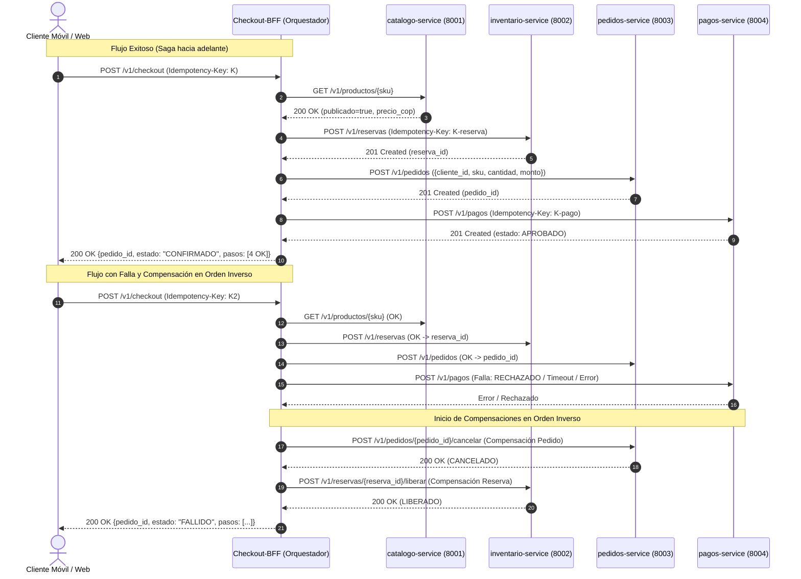

# checkout-bff (P06) — servicio compuesto y orquestador de saga de PiShop Cloud

Autor: Johan Sebastian Rubiano Guzmán · Paquete P06 · Fundamentos de Arquitectura (1419)

Servicio compuesto (Backend For Frontend - BFF) que implementa el patrón **Saga por Orquestación** para coordinar el flujo de compras de PiShop Cloud a través de los servicios de catálogo, inventario, pedidos y pagos. Incluye agregación de datos para la vista móvil (`/v1/vitrina`), compensaciones automáticas ante fallos y control estricto de concurrencia e idempotencia.

---

## Endpoints
| Método | Ruta | Descripción |
|---|---|---|
| POST | `/v1/checkout` | Orquesta la saga de compra (valida catálogo → reserva inventario → crea pedido → cobra). Requiere obligatoriamente `Idempotency-Key` |
| GET | `/v1/checkout/{pedido_id}/estado` | Consulta el estado del checkout y el detalle de pasos/compensaciones ejecutadas |
| GET | `/v1/vitrina` | Agregador BFF: combina productos publicados de catálogo con su stock disponible para móvil (con degradación graciosa) |
| GET | `/health/live` | Sonda de vida (local, barata, nunca toca dependencias) |
| GET | `/health/ready` | Sonda de preparación (verifica arranque y versión de configuración) |
| GET | `/health/startup` | Sonda de inicio (indica si el ciclo de vida del servicio ya arrancó) |

---

## Cómo ejecutarlo

### En entorno local (Python)
```bash
cd services/checkout-bff
pip install -r requirements.txt
python -m uvicorn app.main:app --port 8080 --reload
python -m pytest -v
```

### Con Docker Compose (desde la raíz)
```bash
docker compose up -d consul redis postgres checkout-bff
```

---

## Configuración externalizada (`PISHOP_*`)

Toda la configuración entra por variables de entorno con prefijo `PISHOP_` (Factor III de Twelve-Factor). Los secretos utilizan `SecretStr` para evitar fugas en logs.

| Variable | Por defecto | En Docker Compose | Descripción |
|---|---|---|---|
| `PISHOP_SERVICE_NAME` | `checkout-bff` | `checkout-bff` | Identificador del microservicio en la malla |
| `PISHOP_HTTP_PORT` | `8080` | `8080` | Puerto HTTP en el que escucha el servicio |
| `PISHOP_APP_ENV` | `dev` | `dev` | Entorno de despliegue (`dev`, `qa`, `stg`, `prod`) |
| `PISHOP_DATABASE_URL` | `sqlite+aiosqlite:///./local.db` | — | URL de base de datos local (PostgreSQL en Docker) |
| `PISHOP_DATABASE_PASSWORD` | `cambiar-en-entorno` | — | Contraseña protegida de base de datos (`SecretStr`) |
| `PISHOP_CATALOGO_URL` | `http://localhost:8001` | `http://catalogo-service:8001` | URL base de catalogo-service (P01) |
| `PISHOP_TIMEOUT_CATALOGO_SECONDS` | `2.0` | — | Timeout explícito para llamadas a catálogo |
| `PISHOP_INVENTARIO_URL` | `http://localhost:8002` | `http://inventario-service:8002` | URL base de inventario-service (P02) |
| `PISHOP_TIMEOUT_INVENTARIO_SECONDS` | `2.0` | — | Timeout explícito para llamadas a inventario |
| `PISHOP_PEDIDOS_URL` | `http://localhost:8003` | `http://pedidos-service:8003` | URL base de pedidos-service (P03) |
| `PISHOP_TIMEOUT_PEDIDOS_SECONDS` | `2.0` | — | Timeout explícito para llamadas a pedidos |
| `PISHOP_PAGOS_URL` | `http://localhost:8004` | `http://pagos-service:8004` | URL base de pagos-service (P04) |
| `PISHOP_TIMEOUT_PAGOS_SECONDS` | `2.0` | — | Timeout explícito para llamadas a pagos |
| `PISHOP_HTTP_TIMEOUT_SECONDS` | `2.0` | — | Timeout general de llamadas HTTP |

> **Nota sobre el puerto en Docker Compose:** El contrato del parcial fija el puerto interno en 8080. El Compose lo publica como `8081:8080` en el host para evitar conflicto con el servicio Windows `MTAgentService` del equipo de desarrollo. En producción (o si no hay conflicto) debería ser `8080:8080`. Esta decisión debe confirmarse con P12 (responsable de la infraestructura).

---

## Diagrama de la Saga y Compensaciones (Mermaid)



---

## Decisiones de diseño y justificación para sustentación oral

1. **Orquestación vs. Coreografía**:
   * *Justificación oral:* Se eligió saga por orquestación porque el checkout requiere una respuesta síncrona inmediata al cliente y permite centralizar la lógica de compensación y reintentos en el BFF sin acoplar los servicios core entre sí.
2. **ID de correlación (`pedido_id`)**:
   * *Justificación oral:* El contrato de inventario exige `pedido_id` en el paso 2 pero pedidos genera su identificador en el paso 3; el BFF genera un UUID de correlación para la reserva y lo asocia luego al pedido para desacoplar ambos contratos.
3. **Almacenamiento de idempotencia y concurrencia**:
   * *Justificación oral:* Se implementa caché en memoria protegida por bloqueos concurrentes (`asyncio.Lock` por clave) para garantizar que dos peticiones simultáneas con la misma cabecera no dupliquen cobros ni reservas sin requerir base de datos externa no provista al BFF.
4. **Timeouts explícitos individuales**:
   * *Justificación oral:* Cada servicio downstream tiene configurado su propio timeout (2.0 s) a través de un único `httpx.AsyncClient` reutilizable en el lifespan, previniendo el agotamiento de sockets y asegurando que un servicio lento o caído no bloquee el hilo.
5. **Degradación graciosa en vitrina (`/v1/vitrina`)**:
   * *Justificación oral:* Si inventario no responde para un producto publicado, se entrega con stock en 0 en lugar de tumbar la respuesta completa para el móvil, priorizando la disponibilidad sobre la consistencia estricta.
6. **Pago RECHAZADO vs. PENDIENTE**:
   * *Justificación oral:* RECHAZADO significa que la pasarela nunca realizó el cobro, por lo que no se llama al reembolso (no hay dinero que devolver). PENDIENTE es ambiguo; se trata conservadoramente como fallo con reembolso para evitar cobros dobles al reintentar.

### Debilidades conocidas (documentadas honestamente)

* **Pérdida de `pago_id`/`pedido_id` en timeout**: Si el servicio de pagos o pedidos responde lento y supera el timeout, el BFF no obtiene el ID generado y no puede compensar ese paso directamente. Mitigación: el cliente puede reintentar con la **misma `Idempotency-Key` derivada** (`{clave}-pago` o `{clave}-reserva`), que el servicio downstream debe descartar por idempotencia.
* **Idempotencia en memoria**: El `IDEMPOTENCIA_STORE` vive en RAM y se pierde al reiniciar el proceso o al escalar horizontalmente. En producción debería persistirse en Redis o base de datos.
* **Saga fallida bloqueada por clave**: Una saga que falla por error transitorio queda almacenada como `FALLIDO` para esa clave de idempotencia. Para reintentar se debe usar una **clave nueva**; la clave usada no se puede reutilizar.
* **Locks no distribuidos**: Los `asyncio.Lock` por clave garantizan concurrencia dentro de un proceso, pero no entre réplicas. Con múltiples instancias podría haber duplicados hasta implementar locks en Redis.

---

## Evidencia reproducible

### 1. Ejecución de pruebas unitarias (`pytest -q`)
18 pruebas unitarias pasando con dobles de prueba (`httpx.MockTransport`), sin depender de servicios externos. Salida real ejecutada el 2026-11-07:

```
(fundamentos_arquitectura_politecnico-main) C:\...\fundamentos_arquitectura_politecnico-main>python3.13 -m pytest services/checkout-bff/tests -q
..................                                                       [100%]
============================== warnings summary ===============================
  StarletteDeprecationWarning: Using `httpx` with `starlette.testclient` is deprecated; install `httpx2` instead.
  StarletteDeprecationWarning: 'HTTP_422_UNPROCESSABLE_ENTITY' is deprecated. Use 'HTTP_422_UNPROCESSABLE_CONTENT' instead.

-- Docs: https://docs.pytest.org/en/stable/how-to/capture-warnings.html
18 passed, 2 warnings in 24.22s
```

### 2. Validador oficial del curso (`validar_entrega.py`)
Salida real ejecutada el 2026-11-07:

```
C:\...\fundamentos_arquitectura_politecnico-main>python3.13 herramientas/validar_entrega.py checkout-bff

== checkout-bff (rol P06, puerto 8080) ==
  [ok] POST   /v1/checkout
  [ok] GET    /v1/checkout/{pedido_id}/estado
  [ok] GET    /v1/vitrina
  [ok] sonda /health/live -> 200
  [ok] sonda /health/ready -> 200
  [ok] sonda /health/startup -> 200
  [ok] sin configuración embebida (0 hallazgos)

Resumen: {'checkout-bff': 'OK'}
```

### 3. Evidencia con `curl`

> **Pendiente para ejecución por el estudiante:** Las llamadas `curl` requieren el servicio levantado y los servicios downstream disponibles (o dobles locales). Se incluyen los comandos y la respuesta esperada según el contrato:

```bash
# Levantar el servicio (desde services/checkout-bff/)
PISHOP_APP_ENV=dev uvicorn app.main:app --port 8080

# 1. Sonda de salud (sin dependencias externas, debe responder siempre)
curl -s http://localhost:8080/health/live
# Respuesta esperada: {"status":"alive","instance":"checkout-bff-XXXXX"}

# 2. Validación de ausencia de Idempotency-Key (422, sin servicios externos)
curl -s -X POST http://localhost:8080/v1/checkout \
  -H "Content-Type: application/json" \
  -d '{"cliente_id":"CLI-1","sku":"CAFE-500G","cantidad":2,"medio_pago":"tarjeta"}'
# Respuesta esperada: {"detalle":"La cabecera 'Idempotency-Key' es obligatoria para el checkout","codigo":"IDEMPOTENCY_KEY_REQUERIDA"}

# 3. Consulta de pedido inexistente (404, sin servicios externos)
curl -s http://localhost:8080/v1/checkout/PED-INEXISTENTE/estado
# Respuesta esperada: {"detalle":"Pedido con ID 'PED-INEXISTENTE' no encontrado","codigo":"PEDIDO_NO_ENCONTRADO"}
```

---

## Declaración de uso de IA generativa
En cumplimiento de la política de transparencia académica del curso (secciones 5 y 7 de `docs/ENUNCIADO.md`):
* **Qué parte se apoyó con IA:**
  - Diseño de la estructura del orquestador de saga, lógica de compensaciones en reversa y la distinción RECHAZADO/PENDIENTE en `app/saga.py`.
  - Configuración de la suite de pruebas unitarias con dobles `httpx.MockTransport` en `tests/test_saga.py` (incluyendo prueba de concurrencia con `asyncio.gather` y `ASGITransport`) y `tests/test_vitrina.py`.
  - Elaboración del diagrama de secuencias Mermaid, tabla de configuración y secciones de decisiones y debilidades en este `README.md`.
  - Corrección de URLs en `docker-compose.yml` para que el BFF encuentre los servicios downstream dentro de la red Docker.
* **Qué verifiqué y ejecuté personalmente:**
  - Ejecución y aprobación del 100 % de las pruebas unitarias: `python3.13 -m pytest services/checkout-bff/tests -q` → **18 passed**.
  - Ejecución del validador oficial: `python3.13 herramientas/validar_entrega.py checkout-bff` → **Resumen: OK** (0 secretos embebidos).
  - Revisión de la lógica de compensación, distinción RECHAZADO vs. PENDIENTE y el comportamiento de concurrencia para poder sustentarlos oralmente.
  - Verificación de que `.vscode/` no fue incluido en ningún commit.
