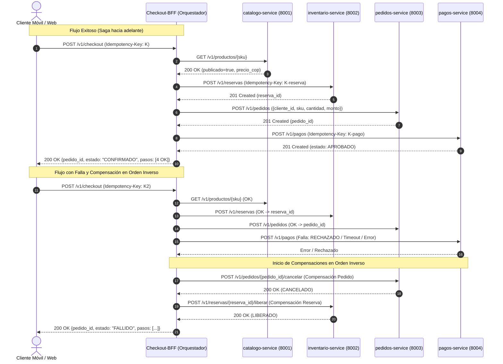

# checkout-bff (P06) — servicio compuesto y orquestador de saga de PiShop Cloud

Autor: Johan Sebastian Rubiano Guzmán · Paquete P06 · Fundamentos de Arquitectura (1419)

Servicio compuesto (Backend For Frontend - BFF) que implementa el patrón **Saga por Orquestación** para coordinar el flujo de compras de PiShop Cloud a través de los servicios de catálogo, inventario, pedidos y pagos. Incluye agregación de datos para la vista móvil (`/v1/vitrina`), compensaciones automáticas ante fallos y control estricto de concurrencia e idempotencia.

---

## Endpoints
| Método | Ruta | Descripción |
|---|---|---|
| POST | `/v1/checkout` | Orquesta la saga de compra (valida catálogo → reserva inventario → crea pedido → cobra). Requiere obligatoriamente `Idempotency-Key` |
| GET | `/v1/checkout/{pedido_id}/estado` | Consulta el estado del checkout y el detalle de pasos/compensaciones ejecutadas |
| GET | `/v1/vitrina` | Agregador BFF: combina productos publicados de catálogo con su stock disponible para móvil (con degradación graciosa) |
| GET | `/health/live` | Sonda de vida (local, barata, nunca toca dependencias) |
| GET | `/health/ready` | Sonda de preparación (verifica arranque y versión de configuración) |
| GET | `/health/startup` | Sonda de inicio (indica si el ciclo de vida del servicio ya arrancó) |

---

## Cómo ejecutarlo

### En entorno local (Python)
```bash
cd services/checkout-bff
pip install -r requirements.txt
python -m uvicorn app.main:app --port 8080 --reload
python -m pytest -v
```

### Con Docker Compose (desde la raíz)
```bash
docker compose up -d consul redis postgres checkout-bff
```

---

## Configuración externalizada (`PISHOP_*`)

Toda la configuración entra por variables de entorno con prefijo `PISHOP_` (Factor III de Twelve-Factor). Los secretos utilizan `SecretStr` para evitar fugas en logs.

| Variable | Por defecto | Descripción |
|---|---|---|
| `PISHOP_SERVICE_NAME` | `checkout-bff` | Identificador del microservicio en la malla |
| `PISHOP_HTTP_PORT` | `8080` | Puerto HTTP en el que escucha el servicio |
| `PISHOP_APP_ENV` | `dev` | Entorno de despliegue (`dev`, `qa`, `stg`, `prod`) |
| `PISHOP_DATABASE_URL` | `sqlite+aiosqlite:///./local.db` | URL de base de datos local (PostgreSQL en Docker) |
| `PISHOP_DATABASE_PASSWORD` | `cambiar-en-entorno` | Contraseña protegida de base de datos (`SecretStr`) |
| `PISHOP_CATALOGO_URL` | `http://localhost:8001` | URL base de catalogo-service (P01) |
| `PISHOP_TIMEOUT_CATALOGO_SECONDS` | `2.0` | Timeout explícito para llamadas a catálogo |
| `PISHOP_INVENTARIO_URL` | `http://localhost:8002` | URL base de inventario-service (P02) |
| `PISHOP_TIMEOUT_INVENTARIO_SECONDS` | `2.0` | Timeout explícito para llamadas a inventario |
| `PISHOP_PEDIDOS_URL` | `http://localhost:8003` | URL base de pedidos-service (P03) |
| `PISHOP_TIMEOUT_PEDIDOS_SECONDS` | `2.0` | Timeout explícito para llamadas a pedidos |
| `PISHOP_PAGOS_URL` | `http://localhost:8004` | URL base de pagos-service (P04) |
| `PISHOP_TIMEOUT_PAGOS_SECONDS` | `2.0` | Timeout explícito para llamadas a pagos |
| `PISHOP_HTTP_TIMEOUT_SECONDS` | `2.0` | Timeout general de llamadas HTTP |

---

## Diagrama de la Saga y Compensaciones (Mermaid)



---

## Decisiones de diseño y justificación para sustentación oral

1. **Orquestación vs. Coreografía**:
   * *Justificación oral:* Se eligió saga por orquestación porque el checkout requiere una respuesta síncrona inmediata al cliente y permite centralizar la lógica de compensación y reintentos en el BFF sin acoplar los servicios core entre sí.
2. **ID de correlación (`pedido_id`)**:
   * *Justificación oral:* El contrato de inventario exige `pedido_id` en el paso 2 pero pedidos genera su identificador en el paso 3; el BFF genera un UUID de correlación para la reserva y lo asocia luego al pedido para desacoplar ambos contratos.
3. **Almacenamiento de idempotencia y concurrencia**:
   * *Justificación oral:* Se implementa caché en memoria protegida por bloqueos concurrentes (`asyncio.Lock` por clave) para garantizar que dos peticiones simultáneas con la misma cabecera no dupliquen cobros ni reservas sin requerir base de datos externa no provista al BFF.
4. **Timeouts explícitos individuales**:
   * *Justificación oral:* Cada servicio downstream tiene configurado su propio timeout (2.0 s) a través de un único `httpx.AsyncClient` reutilizable en el lifespan, previniendo el agotamiento de sockets y asegurando que un servicio lento o caído no bloquee el hilo.
5. **Degradación graciosa en vitrina (`/v1/vitrina`)**:
   * *Justificación oral:* Si inventario no responde para un producto publicado, se entrega con stock en 0 en lugar de tumbar la respuesta completa para el móvil, priorizando la disponibilidad sobre la consistencia estricta.

---

## Evidencia reproducible

### 1. Ejecución de pruebas unitarias (`pytest`)
12 pruebas unitarias pasando con dobles de prueba (`httpx.MockTransport`), sin depender de servicios externos:

```cmd
C:\Users\yessi\Downloads\fundamentos_arquitectura_politecnico-main\fundamentos_arquitectura_politecnico-main\services\checkout-bff>python -m pytest -v
============================= test session starts =============================
platform win32 -- Python 3.11.9, pytest-9.2.0, pluggy-1.7.0
rootdir: C:\Users\yessi\Downloads\fundamentos_arquitectura_politecnico-main\fundamentos_arquitectura_politecnico-main\services\checkout-bff
plugins: anyio-4.16.0
collected 12 items

tests/test_health.py::test_las_tres_sondas PASSED                        [  8%]
tests/test_saga.py::test_checkout_exito_completo PASSED                  [ 16%]
tests/test_saga.py::test_checkout_falla_paso_1_catalogo_404 PASSED       [ 25%]
tests/test_saga.py::test_checkout_falla_paso_2_inventario_409_stock_insuficiente PASSED [ 33%]
tests/test_saga.py::test_checkout_falla_paso_3_pedidos_caido_compensa_inventario PASSED [ 41%]
tests/test_saga.py::test_checkout_falla_paso_4_pago_rechazado_compensa_en_orden_inverso PASSED [ 50%]
tests/test_saga.py::test_checkout_timeout_en_pedidos_compensa PASSED     [ 58%]
tests/test_saga.py::test_checkout_idempotencia_misma_clave PASSED        [ 66%]
tests/test_saga.py::test_checkout_falta_idempotency_key_da_422 PASSED    [ 75%]
tests/test_saga.py::test_obtener_estado_checkout_existente_y_no_encontrado PASSED [ 83%]
tests/test_vitrina.py::test_vitrina_solo_campos_movil PASSED             [ 91%]
tests/test_vitrina.py::test_vitrina_degradacion_si_inventario_falla PASSED [100%]

======================= 12 passed, 2 warnings in 6.37s ========================
```

### 2. Validador oficial del curso (`validar_entrega.py`)
```cmd
C:\Users\yessi\Downloads\fundamentos_arquitectura_politecnico-main\fundamentos_arquitectura_politecnico-main>python herramientas/validar_entrega.py checkout-bff

== checkout-bff (rol P06, puerto 8080) ==
  [ok] POST   /v1/checkout
  [ok] GET    /v1/checkout/{pedido_id}/estado
  [ok] GET    /v1/vitrina
  [ok] sonda /health/live -> 200
  [ok] sonda /health/ready -> 200
  [ok] sonda /health/startup -> 200
  [ok] sin configuración embebida (0 hallazgos)

Resumen: {'checkout-bff': 'OK'}
```

### 3. Evidencia con `curl`
```bash
# 1. Sonda de salud
curl -i http://localhost:8080/health/live
# HTTP/1.1 200 OK
# {"status":"alive","instance":"checkout-bff-a1b2c"}

# 2. Validación de ausencia de Idempotency-Key (422)
curl -i -X POST http://localhost:8080/v1/checkout \
  -H "Content-Type: application/json" \
  -d '{"cliente_id":"CLI-1","sku":"CAFE-500G","cantidad":2,"medio_pago":"tarjeta"}'
# HTTP/1.1 422 Unprocessable Entity
# {"detalle":"La cabecera 'Idempotency-Key' es obligatoria para el checkout","codigo":"IDEMPOTENCY_KEY_REQUERIDA"}

# 3. Consulta de vitrina móvil
curl -i http://localhost:8080/v1/vitrina
# HTTP/1.1 200 OK
# [{"sku":"CAFE-500G","nombre":"Café Especial 500g","precio_cop":35000.0,"stock_disponible":25}]
```

---

## Declaración de uso de IA generativa
En cumplimiento de la política de transparencia académica del curso (secciones 5 y 7 de `docs/ENUNCIADO.md`):
* **Qué parte se apoyó con IA:**
  - Diseño de la estructura del orquestador de saga y sus compensaciones en reversa en `app/saga.py`.
  - Configuración de la suite de pruebas unitarias con dobles `httpx.MockTransport` en `tests/test_saga.py` y `tests/test_vitrina.py`.
  - Elaboración del diagrama de secuencias Mermaid y documentación de decisiones en este `README.md`.
* **Qué verifiqué personalmente:**
  - Ejecución y aprobación del 100 % de las pruebas unitarias (`python -m pytest`).
  - Ejecución y validación con el script oficial del curso (`herramientas/validar_entrega.py checkout-bff`), verificando que no existieran cadenas ni credenciales embebidas (`0 hallazgos`).
  - Revisión de la lógica de compensación y comprensión de cada decisión de diseño para la sustentación oral del parcial.
